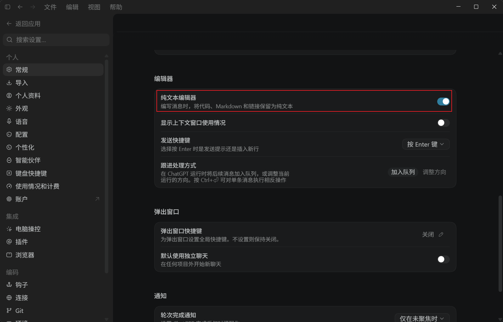

# ChatGPT 客户端与 VS Code Codex 插件：启用纯文本输入，规避路径转义问题

记录日期：2026-09-28。

含下划线的路径在富文本输入、Markdown 序列化过程中可能发生变化。可以优先尝试启用已有的纯文本模式：**ChatGPT 客户端使用设置界面的开关，VS Code Codex 插件使用用户设置中的 `chatgpt.composerPlainTextMode`。** 两种操作分别说明如下，无需修改安装包。

本文的依据包括客户端设置截图、社区报告和本机安装包静态代码检查。VS Code 配置已确认存在读取链路，但本次调查尚未完成开启后的界面端到端复测；不将它描述为所有版本都已验证的官方修复。

## 背景：为什么路径明明正确，却提示不存在？

我此前提交了 [openai/codex #41063：VS Code 插件粘贴路径时转义下划线](https://github.com/openai/codex/issues/41063)，报告 Windows 下 Codex IDE 扩展把路径中的 `_` 变成 `\_`，并提出提供与桌面端相同的纯文本编辑器选项。该记录是 Issue，不是代码修复 PR；提交时的环境为扩展 `26.5820.71523`、VS Code `1.135.0`。

另一个相关记录是 [openai/codex #41486：桌面端显示正确，但模型收到的路径多出反斜杠](https://github.com/openai/codex/issues/41486)。其讨论更详细，补充了多个版本的复现、实际文件操作影响、绕过方法及客户端代码调查。本文优先引用自己的 IDE 问题报告，同时用这份桌面端讨论补充背景；两个 Issue 分别涉及 IDE 扩展和桌面端，不应直接当作同一版本、同一实现的验证。

例如，原始路径为：

```text
C:\work\my_project\test_file.py
```

模型收到或工具使用的路径却可能变成：

```text
C:\work\my\_project\test\_file.py
```

Windows 将反斜杠视为目录分隔符，因此这会改变文件系统目标，并可能导致查找失败或写入错误目录。消息气泡显示正确，并不能证明发送内容保持原样。

两份报告中的后续调查提供了不同层面的证据：

- **IDE 扩展：** [#41063 下的补充复现](https://github.com/openai/codex/issues/41063#issuecomment-5447854289)报告，直接输入 `short_open_tag` 后，持久化用户消息出现反斜杠；召回并重发还会累积转义。该用户另行通过捆绑的 app-server 直接输入相同文本，记录保持原样。这将该次复现的范围缩小到 IDE Webview 输入框／历史消息序列化路径，而非 app-server 或会话写入器。复现版本为扩展 `26.5825.31414`（预发布版）。
- **桌面端：** [#41486 下的客户端代码调查](https://github.com/openai/codex/issues/41486#issuecomment-5751240185)进一步给出富文本转 Markdown 的序列化调用链，并解释显示内容与提交内容为什么可能不同。

这些是针对特定版本的社区调查，不是维护者对所有客户端和版本的正式根因确认。

## 一、ChatGPT 客户端：打开“纯文本编辑器”

对于设置界面中提供此选项的 ChatGPT 客户端：

1. 打开设置，进入“常规”。
2. 找到“编辑器”分组中的“纯文本编辑器”（英文可能显示为 `Plain text composer`）。
3. 打开开关。
4. 新建聊天，重新输入或粘贴原始文本，并按下文方法验证。



开关说明为：“编写消息时，将代码、Markdown 和链接保留为纯文本”。它作用于消息编写过程，不是关闭助手回复的 Markdown 渲染，也不会修复已经发送的历史消息。

不同客户端和版本的界面可能不同。如果看不到该选项，不能直接认定本机已支持。作为补充，本次检查的 Windows `OpenAI.Codex` 桌面包 `26.924.2738.0` 中也存在相同设置及输入框接入代码；**这个桌面包版本不代表所有 ChatGPT 客户端版本**。

## 二、VS Code Codex 插件：添加纯文本配置

### 操作步骤

1. 在 VS Code 中按 `Ctrl+Shift+P`。
2. 执行“首选项：打开用户设置(JSON)”（`Preferences: Open User Settings (JSON)`）。使用此命令可定位当前配置文件，避免修改到别的 Profile。
3. 在已有 JSON 对象中添加下面这一项，保留其他设置，注意相邻属性之间的逗号：

```json
"chatgpt.composerPlainTextMode": true
```

如果设置文件原本为空，完整内容可以写成：

```json
{
  "chatgpt.composerPlainTextMode": true
}
```

4. 保存，执行 `Developer: Reload Window`（开发人员：重新加载窗口）。
5. 打开 Codex，新建聊天后重新输入测试文本。

该项属于 **VS Code 用户设置**，不要写进 Codex 的 `config.toml`。若仍不生效，检查当前 Profile 是否正确，以及工作区设置是否显式把同名配置设为了 `false`。

### 为什么认为这个配置有效？

本次检查对象为本机安装的 `openai.chatgpt` 扩展，版本 `26.5917.62051`。在扩展发布包的 `out/extension.js` 和 `webview/assets/*.js` 中确认了以下链路：

```text
VS Code workspace.getConfiguration("chatgpt")
  → 读取 composerPlainTextMode
  → 配置定义：布尔值，默认 false
  → 输入框接收 plainTextMode
  → 使用已有纯文本模式
```

当前检查版本的 `package.json` 没有向 VS Code 注册这一设置项，因此编辑器可能提示“未知配置设置”。但插件运行时代码仍然读取它；设置界面未公开和底层未实现是两回事。

上述结论来自**本地扩展发布包**，不是来自 `openai/codex` 公开仓库中可对应的 Webview 源码，也不意味着这是已正式文档化、保证长期兼容的选项。开启后请按下面的方法实测。

### 插件更新后需要重新修改吗？

通常不需要。这里修改的是用户设置，插件更新通常不会覆盖它。只要新版继续支持该配置，值就可以继续生效。

更新后如果行为改变，先确认设置仍为 `true`，重载窗口并复测。如果新版移除或改名了该配置，则需重新核对实现，不能保证永久兼容。当前方案不涉及修改 `extension.js`、Webview JavaScript 或桌面端 `app.asar`，因此无需每次更新重打补丁。

恢复富文本模式时，将该项改为 `false`，或删除该项恢复当前版本默认值，然后重载窗口。

## 三、如何验证

新建聊天，将下面的内容复制为普通文本发送，不额外包裹代码块，以测试普通输入是否保持原样：

```text
不要执行任何文件操作。请在代码块中逐字复述下面两条路径，不要修正、合并或删除任何字符：
路径 A：C:\Example_Models
路径 B：C:\Example\_Models
```

两条路径必须保持不同：

| 路径 | 含义 |
| --- | --- |
| `C:\Example_Models` | C 盘下面一个目录，名称是 `Example_Models` |
| `C:\Example\_Models` | C 盘下面的 `Example` 目录内，还有一个 `_Models` 子目录 |

注意检查 A 没有增加反斜杠，B 也没有丢失原有反斜杠。不要通过统一删除 `\_` 前面的反斜杠来“修复”，因为 B 本来就是合法路径。

模型复述只能作为快速检查，不能替代对原始提交文本的检查。更严格的排查应比较输入原文与 JSON 解码后的用户消息，确认是否实际多出 `U+005C`（反斜杠），而不是把 JSON 的转义表示误当作文本变化。

展示或分享路径时也应使用代码块或代码格式：普通 Markdown 中的 `\_` 可能显示为 `_`，导致两个不同路径在页面上看起来相同。

## 四、暂时无法启用时

可以尝试将完整路径放进围栏 `text` 代码块：

````markdown
```text
C:\work\my_project\test_file.py
```
````

社区有[重复对照测试](https://github.com/openai/codex/issues/41486#issuecomment-5592367943)支持这一临时绕过方式，但并非所有版本的保证。单纯使用行内反引号、把反斜杠换成正斜杠，或增加提示词约束，都有不可靠的反馈；参见[正斜杠仍失败的案例](https://github.com/openai/codex/issues/41486#issuecomment-5710321452)。
